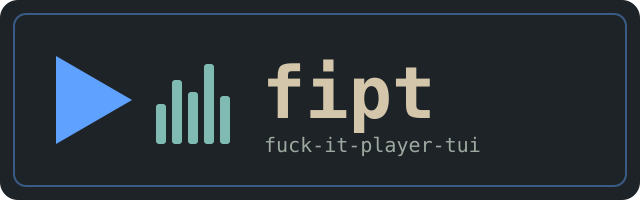
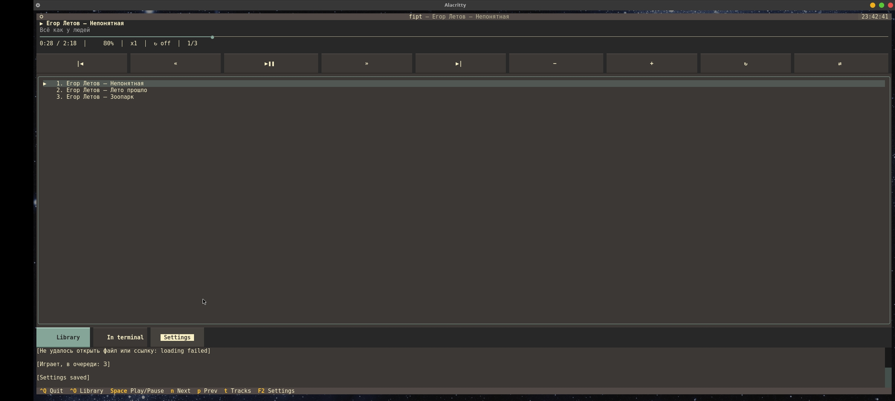

-green)

---

[](README_UA.md) [](README_RU.md)

---



## DESCRIPTION

fipt (fuck-it-player-tui) is a terminal music player built on top of [mpv](https://mpv.io), with a Python [Textual](https://github.com/Textualize/textual) interface. mpv runs in the background and fipt drives it over JSON IPC: queue, seeking, volume, repeat, random order, audio tracks. Works on Linux and Termux.

<p align="center">
  
</p>

## FEATURES

- Queue with track names taken from tags (`Artist — Title`), not file names; broken ID3 encodings (UTF-8 / cp1251 written as Latin-1) are repaired automatically
- Library browser, folders are queued in natural order (`track2` before `track10`); links (YouTube and others via `yt-dlp`) work too
- Repeat (off / track / queue), random order on / off, speed, ReplayGain, audio track and subtitle selection
- The queue and volume are restored on the next launch
- Click the progress bar to seek; everything is also on hotkeys
- Themes with a built-in editor, interface in English / Русский / Українська
- Your own `mpv.conf` keeps working; extra mpv arguments can be set in the settings
- Video is off by default (audio only); `V` plays the current queue right in the terminal

## REQUIREMENTS

Python 3.10+, [mpv](https://mpv.io) (0.38+ recommended: older versions can't restore the order after random mode), and the Textual library. Optional: `mutagen` (track names from tags) and `yt-dlp` (YouTube and other links). Linux, Termux.

## Instructions for Termux

```bash
pkg install python mpv git -y
```

```bash
pkg install yt-dlp -y
```

```bash
pip install textual mutagen
```

```bash
git clone https://github.com/papa-mux/fipt
```

```bash
cd fipt
```

Installation

After cloning, run the installer from the root of the repository:

```bash
bash install.sh
```

The script will ask you to select a language (English / Русский / Українська), then:

· Check Python, Textual, mpv, and tell you what is missing (nothing is installed behind your back).
· Copy the project to $PREFIX/share/fipt in Termux, /usr/local/share/fipt as root, or ~/.local/share/fipt otherwise.
· Create the fipt command next to it (bin/fipt) that runs the installed copy.
· Write the chosen language to the settings if there are none yet (existing settings are never overwritten).

After installation you can run the player from anywhere:

```bash
fipt
```

Settings are saved in:

```
~/.config/fipt/settings.json
```

The previous queue is in queue.json next to it, your own themes are in themes/.

Non-interactive: bash install.sh --lang en; another location: bash install.sh --prefix /some/dir. You can also run it without installing, straight from the repository: ./fipt.

Instructions for Debian / Ubuntu

```bash
sudo apt install python3 python3-pip mpv git -y
```

```bash
sudo apt install yt-dlp
```

(--break-system-packages is needed to install without venv.)

```bash
pip3 install textual mutagen --break-system-packages
```

```bash
git clone https://github.com/papa-mux/fipt.git
```

```bash
cd fipt
```

Then run fipt with that environment's python, or run the installer as root (files go to /usr/local/share/fipt and bin/fipt):

```bash
sudo bash install.sh
```

---

Usage

fipt opens the player and restores the previous queue. To play something right away, pass files, folders or links:

```bash
fipt
fipt song.mp3 ~/Music https://youtu.be/...
```

Hotkeys

Key Action
Space Play / pause (on an empty player — start the queue)
← → Seek (step is configurable)
N / P Next / previous track
+ − · M Volume · mute
R Repeat: off → track → queue
X Random order on / off (off restores the original order, mpv ≥ 0.38)
[ ] · \ Speed down / up · reset
Enter Play the selected track
Del · Shift+↑/↓ (or K/J) · C Remove · move in the queue · clear the queue
O · U Library · open a link / path
T Audio tracks and subtitles
V Play in the terminal (--vo=tct/kitty/sixel), q returns
F2 · Q Settings · quit

The footer shows the main keys; F2 opens the settings (appearance and themes, playback, language, mpv and folders). Mouse: click the progress bar, buttons and queue rows.

Settings

Main options: video (window / off), replaygain, titles_from_tags, play_folder (queue the whole folder when you start a file), ytdl, remember_queue, remember_volume, seek_step, volume_step, mpv_path, mpv_args, music_dir.

Tests

```bash
python3 tests/run_all.py
```

Textual and mpv are not needed for the tests: the mpv protocol is checked against a fake mpv (tests/fake_mpv.py), the application logic against a Textual stub, tags against a fake mutagen.

What the tests do not cover: drawing and key handling in real Textual, behaviour of a real mpv and a real mutagen, --vo=tct in your terminal. If something breaks, open an issue with the traceback and the output of mpv --version.

How it works

File Purpose
fiptui/mpv.py mpv process and asynchronous JSON IPC client (no UI)
fiptui/media.py, tags.py library, natural sorting, time formatting, tags, mojibake repair
fiptui/app.py main screen, queue, hotkeys, state saving
fiptui/screens/ library, tracks, settings windows, theme editor
fiptui/settings.py, themes.py, i18n.py, commands.py settings, themes, localization, F2 palette
data/, locales/, themes/ defaults, translations (en / ru / ua), built-in themes

---

Updating

Update the player folder:

```bash
cd ~/fipt && git pull
```

Then run the installer again (bash install.sh in Termux, sudo bash install.sh on Debian):

```bash
bash install.sh
```

Settings are kept.

---

Uninstall

```bash
bash install.sh --uninstall
```

Your settings in ~/.config/fipt are kept; delete that folder by hand if you want to.

---

Credits

· abc-pascal-tui — fipt is a direct fork of this project; the architecture, settings, themes, i18n, command palette and modal screens are taken from there.
· mpv — playback engine, a separate program under its own license (GPL / LGPL).
· Textual — the TUI framework the interface is built on.
· mutagen and yt-dlp — optional dependencies for tags and links.

---

License

· fipt — GNU General Public License v3.0 (GPL v3), see LICENSE.
· mpv — a separate program under its own license (GPL / LGPL).

