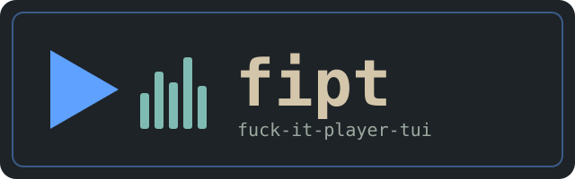
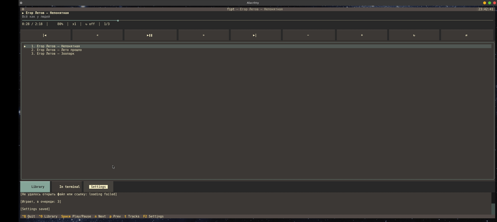

-green)

---

[](README.md) [](README_UA.md)

---



## DESCRIPTION

fipt (fuck-it-player-tui) — терминальный музыкальный плеер на основе [mpv](https://mpv.io) с интерфейсом на Python [Textual](https://github.com/Textualize/textual). mpv работает в фоне, а fipt управляет им по JSON IPC: очередь, перемотка, громкость, повтор, случайный порядок, аудиодорожки. Работает в Linux и Termux.

<p align="center">
  
</p>

## ВОЗМОЖНОСТИ

- Очередь с названиями треков из тегов (`Исполнитель — Название`), а не имён файлов; сломанные кодировки ID3 (UTF-8 / cp1251, записанные как Latin-1) чинятся автоматически
- Обзор библиотеки, папки ставятся в очередь в естественном порядке (`track2` раньше `track10`); работают и ссылки (YouTube и другие через `yt-dlp`)
- Повтор (выкл / трек / очередь), случайный порядок вкл / выкл, скорость, ReplayGain, выбор аудиодорожки и субтитров
- Очередь и громкость восстанавливаются при следующем запуске
- Клик по полосе прогресса перематывает; всё есть и на горячих клавишах
- Темы со встроенным редактором, интерфейс на English / Русский / Українська
- Ваш `mpv.conf` продолжает работать; дополнительные аргументы mpv задаются в настройках
- Видео по умолчанию выключено (только звук); `V` играет текущую очередь прямо в терминале

## ТРЕБОВАНИЯ

Python 3.10+, [mpv](https://mpv.io) (рекомендуется 0.38+: в старых нельзя вернуть порядок после случайного режима) и библиотека Textual. По желанию: `mutagen` (названия треков из тегов) и `yt-dlp` (YouTube и другие ссылки). Linux, Termux.

## Инструкция для Termux

```bash
pkg install python mpv git -y
```

```bash
pkg install yt-dlp -y
```

```bash
pip install textual mutagen
```

```bash
git clone https://github.com/papa-mux/fipt
```

```bash
cd fipt
```

Установка

После клонирования запустите установщик из корня репозитория:

```bash
bash install.sh
```

Скрипт предложит выбрать язык (English / Русский / Українська), а затем:

· Проверит Python, Textual, mpv и скажет, чего не хватает (ничего не ставится без вашего ведома).
· Скопирует проект в $PREFIX/share/fipt в Termux, в /usr/local/share/fipt от root или в ~/.local/share/fipt в остальных случаях.
· Создаст рядом команду fipt (bin/fipt), запускающую установленную копию.
· Запишет выбранный язык в настройки, если их ещё нет (существующие настройки не перезаписываются).

После установки плеер запускается из любой папки:

```bash
fipt
```

Настройки сохраняются в:

```
~/.config/fipt/settings.json
```

Прежняя очередь лежит рядом в queue.json, свои темы — в themes/.

Без вопросов: bash install.sh --lang ru; другое место: bash install.sh --prefix /some/dir. Можно и без установки, прямо из репозитория: ./fipt.

Инструкция для Debian / Ubuntu

```bash
sudo apt install python3 python3-pip mpv git -y
```

```bash
sudo apt install yt-dlp
```

(--break-system-packages нужен, чтобы ставить без venv.)

```bash
pip3 install textual mutagen --break-system-packages
```

```bash
git clone https://github.com/papa-mux/fipt.git
```

```bash
cd fipt
```

Запускайте fipt python'ом из этого окружения либо запустите установщик от root (файлы идут в /usr/local/share/fipt и bin/fipt):

```bash
sudo bash install.sh
```

---

Использование

fipt открывает плеер и восстанавливает прежнюю очередь. Чтобы сразу что-то сыграть, передайте файлы, папки или ссылки:

```bash
fipt
fipt song.mp3 ~/Music https://youtu.be/...
```

Горячие клавиши

Клавиша Действие
Space Пуск / пауза (на пустом плеере — старт очереди)
← → Перемотка (шаг настраивается)
N / P Следующий / предыдущий трек
+ − · M Громкость · без звука
R Повтор: выкл → трек → очередь
X Случайный порядок вкл / выкл (выкл возвращает прежний порядок, mpv ≥ 0.38)
[ ] · \ Скорость меньше / больше · сброс
Enter Играть выбранный трек
Del · Shift+↑/↓ (или K/J) · C Убрать · переместить в очереди · очистить очередь
O · U Библиотека · открыть ссылку / путь
T Аудиодорожки и субтитры
V Играть в терминале (--vo=tct/kitty/sixel), возврат по q
F2 · Q Настройки · выход

В подвале показаны основные клавиши; F2 открывает настройки (оформление и темы, воспроизведение, язык, mpv и папки). Мышь: клик по полосе прогресса, кнопкам и строкам очереди.

Настройки

Основные параметры: video (window / off), replaygain, titles_from_tags, play_folder (ставить в очередь всю папку при запуске файла), ytdl, remember_queue, remember_volume, seek_step, volume_step, mpv_path, mpv_args, music_dir.

Тесты

```bash
python3 tests/run_all.py
```

Для тестов не нужны ни Textual, ни mpv: протокол mpv проверяется на фейковом mpv (tests/fake_mpv.py), логика приложения — на заглушке Textual, теги — на подставном mutagen.

Что тесты не покрывают: отрисовку и обработку клавиш в настоящем Textual, поведение настоящих mpv и mutagen, --vo=tct в вашем терминале. Если что-то сломалось — создайте issue с traceback и выводом mpv --version.

Как устроено

Файл Назначение
fiptui/mpv.py процесс mpv и асинхронный клиент JSON IPC (без UI)
fiptui/media.py, tags.py библиотека, естественная сортировка, формат времени, теги, починка кракозябр
fiptui/app.py главный экран, очередь, горячие клавиши, сохранение состояния
fiptui/screens/ библиотека, дорожки, окна настроек, редактор тем
fiptui/settings.py, themes.py, i18n.py, commands.py настройки, темы, локализация, палитра F2
data/, locales/, themes/ значения по умолчанию, переводы (en / ru / ua), встроенные темы

---

Обновление

Обновите папку плеера:

```bash
cd ~/fipt && git pull
```

Затем снова запустите установщик (bash install.sh в Termux, sudo bash install.sh на Debian):

```bash
bash install.sh
```

Настройки сохраняются.

---

Удаление

```bash
bash install.sh --uninstall
```

Ваши настройки в ~/.config/fipt остаются; удалите эту папку вручную, если нужно.

---

Благодарности

· abc-pascal-tui — fipt является прямым форком этого проекта; оттуда взяты архитектура, настройки, темы, i18n, палитра команд и модальные экраны.
· mpv — движок воспроизведения, отдельная программа под собственной лицензией (GPL / LGPL).
· Textual — TUI-фреймворк, на котором построен интерфейс.
· mutagen и yt-dlp — опциональные зависимости для тегов и ссылок.

---

Лицензия

· fipt — GNU General Public License v3.0 (GPL v3), см. LICENSE.
· mpv — отдельная программа со своей лицензией (GPL / LGPL).
