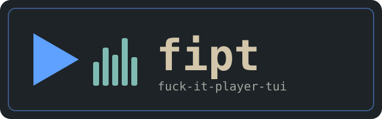
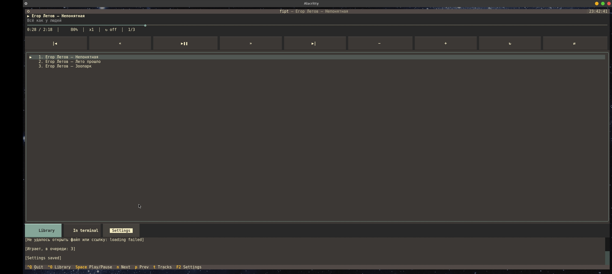

-green)

---

[](README.md) [](README_RU.md)

---



## DESCRIPTION

fipt (fuck-it-player-tui) — терміналний музичний плеєр на основі [mpv](https://mpv.io) з інтерфейсом на Python [Textual](https://github.com/Textualize/textual). mpv працює у фоні, а fipt керує ним через JSON IPC: черга, перемотка, гучність, повтор, випадковий порядок, аудіодоріжки. Працює в Linux і Termux.

<p align="center">
  
</p>

## МОЖЛИВОСТІ

- Черга з назвами треків із тегів (`Виконавець — Назва`), а не імен файлів; зламані кодування ID3 (UTF-8 / cp1251, записані як Latin-1) виправляються автоматично
- Огляд бібліотеки, теки ставляться в чергу в природному порядку (`track2` раніше `track10`); працюють і посилання (YouTube та інші через `yt-dlp`)
- Повтор (вимк / трек / черга), випадковий порядок вкл / вимк, швидкість, ReplayGain, вибір аудіодоріжки та субтитрів
- Черга і гучність відновлюються під час наступного запуску
- Клік по смузі прогресу перемотує; усе є і на гарячих клавішах
- Теми зі вбудованим редактором, інтерфейс English / Русский / Українська
- Ваш `mpv.conf` продовжує працювати; додаткові аргументи mpv задаються в налаштуваннях
- Відео за замовчуванням вимкнено (лише звук); `V` грає поточну чергу просто в терміналі

## ВИМОГИ

Python 3.10+, [mpv](https://mpv.io) (рекомендовано 0.38+: у старих не можна повернути порядок після випадкового режиму) та бібліотека Textual. За бажанням: `mutagen` (назви треків із тегів) і `yt-dlp` (YouTube та інші посилання). Linux, Termux.

## Інструкція для Termux

```bash
pkg install python mpv git -y
```

```bash
pkg install yt-dlp -y
```

```bash
pip install textual mutagen
```

```bash
git clone https://github.com/papa-mux/fipt
```

```bash
cd fipt
```

Встановлення

Після клонування запустіть встановлювач із кореня репозиторію:

```bash
bash install.sh
```

Скрипт запропонує обрати мову (English / Русский / Українська), а потім:

· Перевірить Python, Textual, mpv і скаже, чого бракує (нічого не ставиться без вашого відома).
· Скопіює проєкт у $PREFIX/share/fipt у Termux, у /usr/local/share/fipt від root або в ~/.local/share/fipt в інших випадках.
· Створить поруч команду fipt (bin/fipt), що запускає встановлену копію.
· Запише обрану мову в налаштування, якщо їх ще немає (наявні налаштування не перезаписуються).

Після встановлення плеєр запускається з будь-якої теки:

```bash
fipt
```

Налаштування зберігаються в:

```
~/.config/fipt/settings.json
```

Попередня черга лежить поруч у queue.json, власні теми — в themes/.

Без запитань: bash install.sh --lang ua; інше місце: bash install.sh --prefix /some/dir. Можна й без встановлення, прямо з репозиторію: ./fipt.

Інструкція для Debian / Ubuntu

```bash
sudo apt install python3 python3-pip mpv git -y
```

```bash
sudo apt install yt-dlp
```

(--break-system-packages потрібен, щоб ставити без venv.)

```bash
pip3 install textual mutagen --break-system-packages
```

```bash
git clone https://github.com/papa-mux/fipt.git
```

```bash
cd fipt
```

Запускайте fipt python'ом із цього середовища або запустіть встановлювач від root (файли йдуть у /usr/local/share/fipt і bin/fipt):

```bash
sudo bash install.sh
```

---

Використання

fipt відкриває плеєр і відновлює попередню чергу. Щоб одразу щось зіграти, передайте файли, теки або посилання:

```bash
fipt
fipt song.mp3 ~/Music https://youtu.be/...
```

Гарячі клавіші

Клавіша Дія
Space Пуск / пауза (на порожньому плеєрі — старт черги)
← → Перемотка (крок налаштовується)
N / P Наступний / попередній трек
+ − · M Гучність · без звуку
R Повтор: вимк → трек → черга
X Випадковий порядок вкл / вимк (вимк повертає попередній порядок, mpv ≥ 0.38)
[ ] · \ Швидкість менше / більше · скидання
Enter Грати вибраний трек
Del · Shift+↑/↓ (або K/J) · C Прибрати · перемістити в черзі · очистити чергу
O · U Бібліотека · відкрити посилання / шлях
T Аудіодоріжки та субтитри
V Грати в терміналі (--vo=tct/kitty/sixel), повернення по q
F2 · Q Налаштування · вихід

У підвалі показано основні клавіші; F2 відкриває налаштування (оформлення та теми, відтворення, мова, mpv і теки). Миша: клік по смузі прогресу, кнопках і рядках черги.

Налаштування

Основні параметри: video (window / off), replaygain, titles_from_tags, play_folder (ставити в чергу всю теку під час запуску файлу), ytdl, remember_queue, remember_volume, seek_step, volume_step, mpv_path, mpv_args, music_dir.

Тести

```bash
python3 tests/run_all.py
```

Для тестів не потрібні ні Textual, ні mpv: протокол mpv перевіряється на фейковому mpv (tests/fake_mpv.py), логіка застосунку — на заглушці Textual, теги — на підставному mutagen.

Що тести не покривають: відмальовування й обробку клавіш у справжньому Textual, поведінку справжніх mpv і mutagen, --vo=tct у вашому терміналі. Якщо щось зламалось — створіть issue з traceback і виводом mpv --version.

Як це влаштовано

Файл Призначення
fiptui/mpv.py процес mpv і асинхронний клієнт JSON IPC (без UI)
fiptui/media.py, tags.py бібліотека, природне сортування, формат часу, теги, виправлення кракозябрів
fiptui/app.py головний екран, черга, гарячі клавіші, збереження стану
fiptui/screens/ бібліотека, доріжки, вікна налаштувань, редактор тем
fiptui/settings.py, themes.py, i18n.py, commands.py налаштування, теми, локалізація, палітра F2
data/, locales/, themes/ типові значення, переклади (en / ru / ua), вбудовані теми

---

Оновлення

Оновіть теку плеєра:

```bash
cd ~/fipt && git pull
```

Потім знову запустіть встановлювач (bash install.sh у Termux, sudo bash install.sh на Debian):

```bash
bash install.sh
```

Налаштування зберігаються.

---

Видалення

```bash
bash install.sh --uninstall
```

Ваші налаштування в ~/.config/fipt лишаються; видаліть цю теку вручну, якщо потрібно.

---

Подяки

· abc-pascal-tui — fipt є прямим форком цього проєкту; звідти взято архітектуру, налаштування, теми, i18n, палітру команд і модальні екрани.
· mpv — рушій відтворення, окрема програма зі своєю ліцензією (GPL / LGPL).
· Textual — TUI-фреймворк, на якому побудовано інтерфейс.
· mutagen і yt-dlp — опційні залежності для тегів і посилань.

---

Ліцензія

· fipt — GNU General Public License v3.0 (GPL v3), див. LICENSE.
· mpv — окрема програма зі своєю ліцензією (GPL / LGPL).